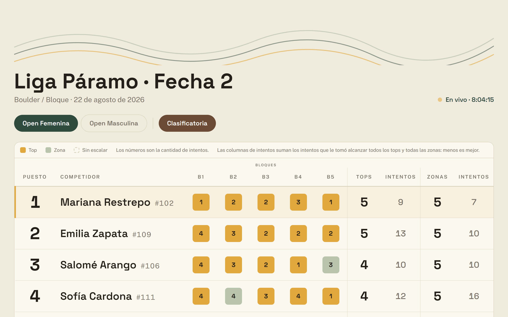
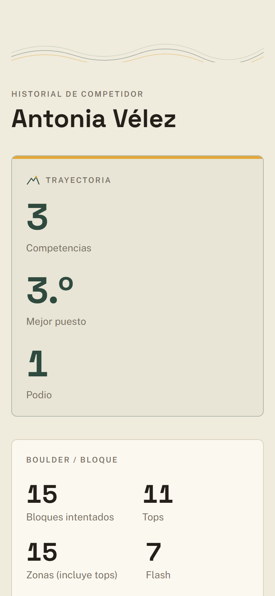

# CRUX

**Plataforma de competencias deportivas, entrando por escalada.**

Una competencia de escalada en Colombia se administra hoy con WhatsApp, un
formulario de Google y alguien gritando puntajes el día del evento. CRUX la corre
de principio a fin: inscripción por enlace, jueces que capturan desde el teléfono
aunque se caiga el wifi, tabla pública que se actualiza sola y una pantalla de
proyección para la sala.

Empieza por el gimnasio y la liga local porque ahí es donde se puede entrar sin
permiso de nadie, pero el modelo —intentos auditables, formatos de puntaje
intercambiables, historial por competidor entre eventos— es el que exige una
federación.

**Demo en vivo:** https://cruxcompetencias.com ·
[tabla de un evento real](https://cruxcompetencias.com/resultados/liga-paramo) ·
[la misma, en modo proyección](https://cruxcompetencias.com/resultados/liga-paramo/proyectar)



## Qué resuelve

| Quién | Qué hace | Necesita cuenta |
|---|---|---|
| Organizador | Crea el evento con sus categorías, rondas y formato de puntaje; publica el enlace de inscripción | Sí, por invitación |
| Competidor | Se inscribe por el enlace y acumula historial entre eventos | No |
| Juez | Captura tops, zonas e intentos desde el teléfono, con o sin señal | No, solo el código del evento |
| Público | Ve la tabla en vivo desde su teléfono o proyectada en la sala | No |

El historial del competidor cruza eventos y formatos de puntaje distintos: no
compara puntajes crudos —que no son comparables entre formatos— sino la posición
relativa al campo de cada evento.



## Las cuatro decisiones que definen el producto

**Los intentos son el hecho; los puntajes son derivados.** Se persiste cada
`Attempt` y nunca un puntaje. Corregir un error del juez es insertar una
corrección, no editar una cifra. Eso hace auditable el evento y desactiva la
discusión más común del día de la competencia.

**El scoring es intercambiable.** Cada gimnasio usa su variante: puntos IFSC,
conteo clásico de tops y zonas, puntos por bloque estilo liga, altura máxima.
`packages/scoring` expone estrategias puras `score(attempts, config) →
RankedResult[]`, cada una con tests de empates reales. Si el scoring estuviera
cableado, cada cliente nuevo sería un fork.

**La captura del juez funciona sin red.** Los gimnasios tienen wifi malo y el
día del evento no hay margen. Los intentos van a IndexedDB con un
`clientAttemptId` propio y una cola de sincronización; el endpoint es idempotente
por ese id.

**La lectura pública se optimiza para picos.** Toda la sala abre la tabla al
mismo tiempo. No se consulta la base por cliente: se recalcula al recibir
intentos y se difunde sobre respuesta cacheada.

El porqué de cada una, en [`docs/00-tesis.md`](docs/00-tesis.md) y
[`docs/01-etapas.md`](docs/01-etapas.md).

## Estructura

Monorepo con pnpm workspaces y Turborepo.

```
apps/web          Next.js 15 (App Router) — organizador, juez y pantallas públicas
packages/core     Dominio puro: elegibilidad, Result<T,E>. Sin IO.
packages/scoring  Estrategias de puntaje. Funciones puras, sin IO.
packages/db       Esquema Drizzle, migraciones y queries. Sin lógica de negocio.
```

Las reglas de dependencia no son negociables: `core` y `scoring` no importan
`db`, `next` ni red — por eso se testean como funciones puras. `apps/web`
orquesta y no reimplementa lo que vive en ellos.

Código en inglés, interfaz en español (es-CO). El glosario de dominio —
`Event`, `Discipline`, `Problem`, `Attempt`, `Registration` y cómo se dicen en
pantalla — está en [`CLAUDE.md`](CLAUDE.md).

## Stack

Node 22 · TypeScript estricto · Next.js 15 · Tailwind · Postgres (Neon) +
Drizzle · Better Auth · Vitest · pnpm + Turborepo.

Sin linter y sin e2e a propósito: `tsc` estricto hace de linter. **Sin librería
de gráficas**: las de la tabla pública son SVG y CSS a mano, 6.5 kB en la
pantalla que abre toda la sala al tiempo, contra los 100 kB y pico de una
librería.

## Arranque

```bash
pnpm install
cp apps/web/.env.example apps/web/.env.local      # completar DATABASE_URL
cp packages/db/.env.example packages/db/.env      # completar DATABASE_URL
pnpm db:migrate                                   # migraciones de packages/db/drizzle
pnpm seed:event                                   # tres eventos demo con inscritos e intentos
pnpm dev
```

Sin `seed:event` la tabla pública no tiene nada que mostrar: hacen falta 20+
inscritos y una sesión entera de intentos para que las gráficas digan algo.
`--reset` los borra y los vuelve a sembrar.

| Comando | Qué hace |
|---|---|
| `pnpm dev` | Levanta la app |
| `pnpm test` | Vitest en todos los paquetes |
| `pnpm typecheck` | `tsc --noEmit` (hace de linter) |
| `pnpm build` | Build de producción |
| `pnpm db:generate` | Genera una migración desde el esquema |
| `pnpm seed:event` | Siembra los tres eventos demo |
| `node scripts/viewport.mjs <url> [ancho]` | Mide una pantalla a un ancho real por CDP y reporta desbordo |

Despliegue (Vercel + Neon), variables de entorno e invitaciones de organizador:
[`docs/despliegue.md`](docs/despliegue.md). Manual de uso para organizadores y
jueces: [`apps/web/public/manual.html`](apps/web/public/manual.html), servido en
`/manual.html`.

## Estado

Etapa 1 (competencias) en producción, con el ciclo completo funcionando:
organizador, inscripción pública con freno por IP, captura del juez offline con
cola de sincronización probada en un iPhone real, tabla pública y perfil de
competidor —ambos con vista propia por debajo de `sm`— y pantalla de proyección
que rota sola. Falta lo que solo da un evento de verdad.

Lo que sigue —diagnóstico biomecánico por video en el navegador, y generador de
bloques— está descrito y **deliberadamente bloqueado** hasta que un gimnasio real
corra un evento con 20+ inscritos sin soporte manual el día del evento. El
detalle de las etapas y qué desbloquea cada una está en
[`CLAUDE.md`](CLAUDE.md) y [`docs/01-etapas.md`](docs/01-etapas.md).
